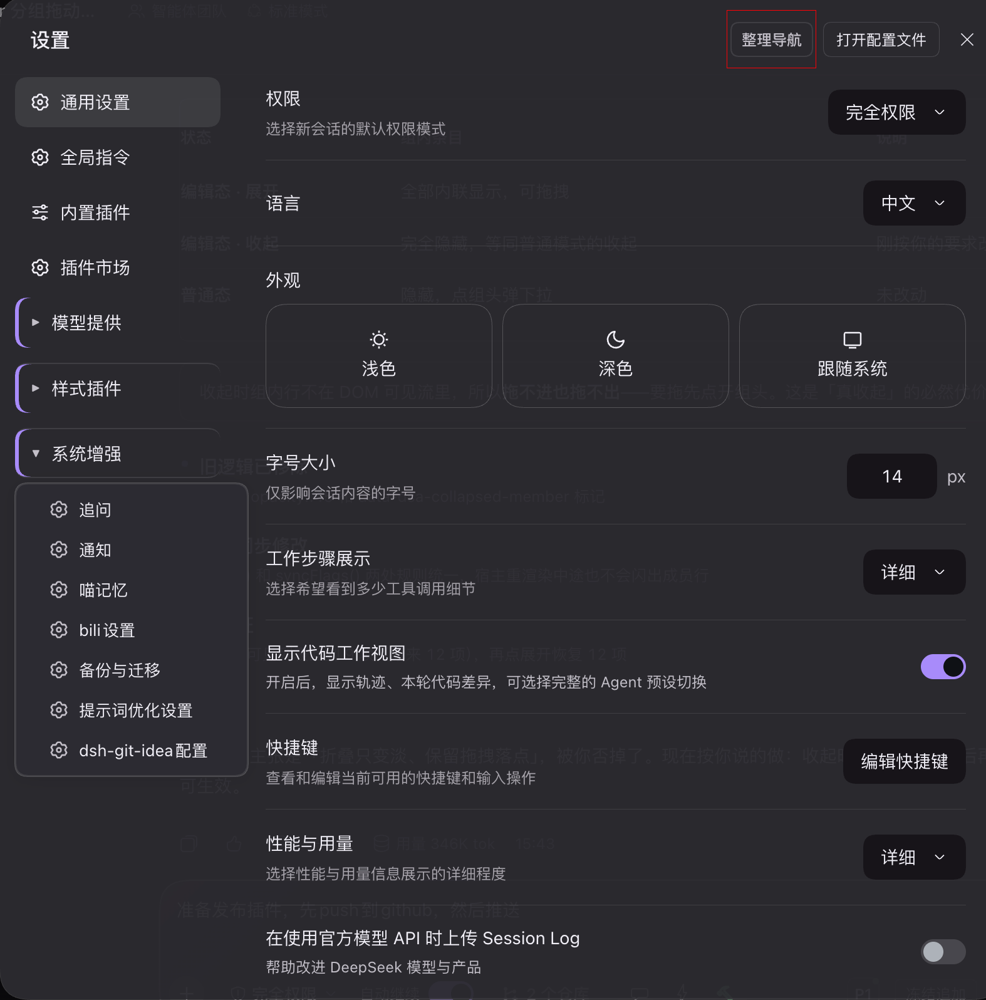
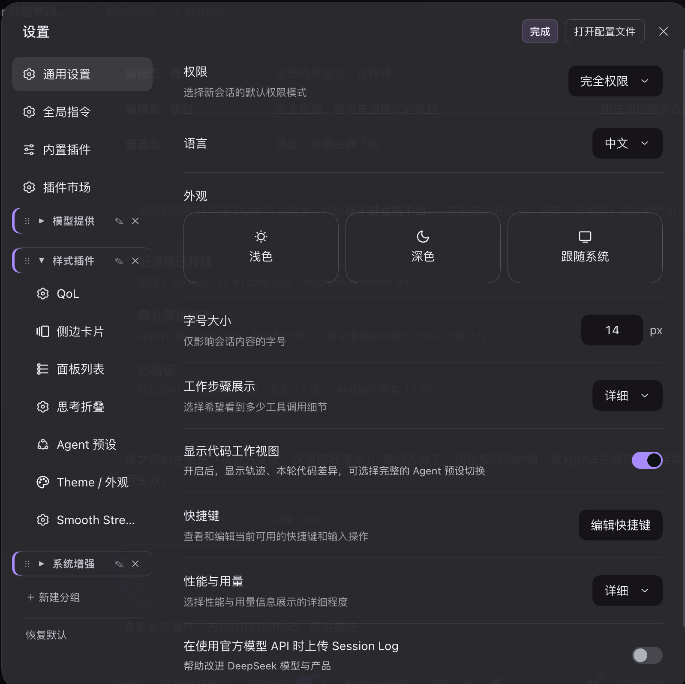

# dsh-settings-arranger

<p align="center">
  <a href="https://www.npmjs.com/package/dsh-settings-arranger"></a>
  <a href="https://www.npmjs.com/package/dsh-settings-arranger"></a>
  <a href="LICENSE"></a>
  <a href="https://github.com/HelloQingTao/dsh-settings-arranger/stargazers"></a>
</p>

**English** | [中文](#中文)

---

## 中文

设置页左侧那一列分区导航，插件装多了就变成一长条：顺序由各插件注册时写死、不能改，官方分区和一堆插件分区混在一起。这个插件给它加上**拖拽排序**和**自定义分组**，排布按浏览器保存，刷新不丢。

### 功能

- **拖拽排序**：任意分区条目拖到任意位置，分组与普通条目混排也行。
- **分组**：把相关分区收进一个组（比如把「追问 / 通知 / 喵记忆」收成「系统增强」），点组头展开。
- **组内排序 / 跨组移动 / 拖出一级**：整理模式下组内条目同样能拖，可拖进别的组，也可拖回一级。
- **新建 / 重命名 / 删除分组**，同名会就地报错。
- **恢复默认**：一键清空排布，回到原生顺序（二次确认）。
- **两套视图**：平时收起成组头、点开是下拉菜单；点「整理导航」进整理模式，组内条目全部内联铺开，方便拖。

### 效果图

日常使用：分组收起成一行，点开是带图标的浮动下拉菜单。



整理模式：点右上角「整理导航」，组内条目全部铺开，可直接拖动排序。



### 安装

```sh
dsh plugin --profile web add dsh-settings-arranger
```

装完刷新 Web GUI（或重启 dsh），bundle 会随包里的 `cordis.patch.yml` 自动注册。

> 用 GitHub 源安装：`dsh plugin --profile web add github:HelloQingTao/dsh-settings-arranger`

### 用法

1. 打开 **设置**，点右上角的 **整理导航**。
2. 点 **＋ 新建分组** 起个名字。
3. 把条目拖进组里，或把分组头拖到别的位置；组内条目可以再拖去别的组，或拖出一级。
4. 点 **完成** 退出整理模式，点分组头就能展开下拉菜单。

排布存在浏览器的 localStorage 里（键 `dsh.settings-arranger.v1`），**按浏览器与站点隔离**，换浏览器或换端口要重新整理。

### 兼容

- dsh `0.2.0-rc.2` 实测通过。
- 纯客户端插件，只操作 DOM，不改任何其它插件的代码；同名的分区顺序仍由各插件自己的 `order` 决定，本插件只是在渲染后再重排。

### 许可证

[MIT](LICENSE)

---

## English

The settings dialog's left nav grows into an unmanageable list once you install a few plugins: order is baked in at registration time and official sections sit interleaved with plugin ones. This plugin adds **drag-to-reorder** and **custom groups**, persisted per browser.

### Features

- **Drag to reorder** any section, mixing groups and plain rows freely.
- **Groups**: collect related sections into one group (e.g. put "Follow-up / Notifications / Meow Memory" under "System"). Click the group head to expand.
- **Reorder inside a group, move across groups, drag back out** — all available in arrange mode.
- **Create / rename / delete groups**, with inline duplicate-name validation.
- **Reset to default** — clears the layout and returns the native order (with confirmation).
- **Two views**: normal mode collapses groups into heads with a floating dropdown; clicking **整理导航 (Arrange)** switches to edit mode where every member is laid out inline for dragging.

### Screenshots

Normal mode — groups collapse into a single row; clicking one opens an icon-carrying dropdown.


Arrange mode — click "整理导航" in the top-right corner; all members expand inline and can be dragged.


### Install

```sh
dsh plugin --profile web add dsh-settings-arranger
```

Refresh the Web GUI (or restart dsh); the bundle registers itself through the shipped `cordis.patch.yml`.

> From GitHub: `dsh plugin --profile web add github:HelloQingTao/dsh-settings-arranger`

### Usage

1. Open **Settings** and click **整理导航** in the top-right corner.
2. Click **＋ 新建分组** and name the group.
3. Drag entries into it, or drag the group head elsewhere; drag members across groups or back to the top level.
4. Click **完成 (Done)** to leave arrange mode, then click a group head to open its dropdown.

The layout lives in the browser's localStorage (key `dsh.settings-arranger.v1`), so it is **per browser and per origin** — a different browser or port starts fresh.

### Compatibility

- Tested with dsh `0.2.0-rc.2`.
- Pure client-side: it only touches the DOM and never modifies other plugins' code. Section order is still declared by each plugin; this plugin simply re-lays-out the rendered nav.

### License

[MIT](LICENSE)
